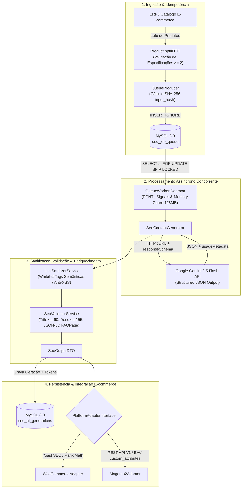

# PHP SEO Pipeline 🚀

[](https://www.php.net/)
[](LICENSE)
[](https://www.php-fig.org/psr/psr-4/)
[](https://ai.google.dev/)

Motor assíncrono de alta concorrência em **PHP 8.2+** projetado para geração, validação, sanitização e enriquecimento de SEO em massa (**Meta Title**, **Meta Description**, **Focus Keyword**, **Descrição HTML Semântica** e **FAQs Estruturadas com Schema.org JSON-LD**) voltado para plataformas de e-commerce de médio e grande porte (**WooCommerce** e **Magento 2**).

---

## 🎯 Visão Geral & Problemas Resolvidos

Operações de enriquecimento de catálogo com Inteligência Artificial Generativa em ambientes de e-commerce tradicionais frequentemente falham ao escalar devido a gargalos arquiteturais e riscos de segurança. O **PHP SEO Pipeline** resolve quatro problemas críticos de engenharia:

1. **Prevenção de Gateway Timeout (`504 Gateway Timeout`):**
   Chamadas síncronas a LLMs durante o salvamento de produtos no painel administrativo bloqueiam workers do PHP-FPM e estouram limites de tempo do Nginx/Cloudflare. Este projeto desacopla a ingestão do processamento por meio de uma fila transacional em MySQL 8 com bloqueio não-bloqueante (`SELECT ... FOR UPDATE SKIP LOCKED`), permitindo que múltiplos daemons CLI processem milhares de SKUs em background com *Exponential Backoff* e *Graceful Shutdown* (`pcntl`).
2. **Eliminação de Alucinações de Atributos:**
   O pipeline bloqueia chamadas à IA para produtos com dados insuficientes através do `ProductInputDTO` (exigindo nome, categoria e no mínimo 2 especificações técnicas reais) e utiliza **Structured Outputs (`responseSchema`)** nativos da API do Google Gemini (`gemini-2.5-flash`), garantindo respostas estritamente tipadas em JSON.
3. **Blindagem contra XSS via Prompt Injection:**
   Descrições geradas por LLMs a partir de dados de fornecedores externos podem conter vetores de Cross-Site Scripting (XSS) ou tags malformadas. O `HtmlSanitizerService` aplica uma *whitelist* estrita (`<h2>, <h3>, <p>, <ul>, <ol>, <li>, <strong>, <em>`) removendo quaisquer scripts, eventos inline (`onload`, `onerror`) ou atributos de estilo antes da persistência.
4. **Idempotência e Controle de Custos (Zero Cobrança Duplicada):**
   O `QueueProducer` calcula um hash criptográfico **SHA-256** (`input_hash`) normalizado a partir dos dados de entrada do produto. A constraint única composta `uk_product_hash (external_product_id, platform, input_hash)` com `INSERT IGNORE` garante que reenvios acidentais do mesmo lote jamais gerem jobs duplicados ou consumo desnecessário de tokens na API do Gemini.

---

## 🏗️ Arquitetura do Sistema



---

## 📂 Estrutura de Diretórios (PSR-4)

O projeto segue estritamente a especificação **PSR-4** sob o namespace raiz `JzGuilherme\SeoPipeline\`:

```text
php-seo-pipeline/
├── bin/
│   ├── worker.php                # Daemon CLI para processar a fila em background
│   └── enqueue-demo.php          # Script CLI para testar enfileiramento de lotes
├── config/
│   └── database.php              # Fábrica de conexão PDO injetável
├── database/
│   └── migrations/
│       └── 001_create_seo_tables.sql  # Tabelas seo_job_queue e seo_ai_generations
├── docker/
│   ├── php/Dockerfile            # PHP 8.3-CLI com extensões pdo_mysql, pcntl, curl, mbstring
│   └── supervisor/seo_worker.conf
├── src/
│   ├── Contracts/
│   │   ├── AiProviderInterface.php
│   │   └── PlatformAdapterInterface.php
│   ├── DTO/
│   │   ├── ProductInputDTO.php
│   │   └── SeoOutputDTO.php
│   ├── Exceptions/
│   │   ├── AiGenerationException.php
│   │   └── SeoValidationException.php
│   ├── Providers/
│   │   └── GeminiAiProvider.php  # Chamada cURL/HTTP com responseSchema JSON estrito
│   ├── Queue/
│   │   ├── QueueProducer.php     # Enfileiramento rápido com hash SHA-256 (Idempotência)
│   │   └── QueueWorker.php       # Consumidor com SELECT ... FOR UPDATE SKIP LOCKED
│   ├── Services/
│   │   ├── HtmlSanitizerService.php # Whitelist estrita (<h2>, <h3>, <p>, <ul>, <li>, <strong>)
│   │   ├── SeoValidatorService.php  # Validação de limites (Title <= 60, Desc <= 155) e JSON-LD FAQPage
│   │   └── SeoContentGenerator.php  # Orquestrador principal
│   └── Adapters/
│       ├── WooCommerceAdapter.php   # Mapeamento para Yoast SEO / Rank Math
│       └── Magento2Adapter.php      # Mapeamento para API REST / EAV do Magento 2
├── tests/
│   └── Unit/
│       └── SeoValidatorServiceTest.php
├── .env.example
├── .gitignore
├── composer.json
├── docker-compose.yml
├── phpunit.xml
└── README.md
```

---

## ⚙️ Guia de Instalação e Execução

### Pré-requisitos
- **Docker** e **Docker Compose** (Recomendado para produção/desenvolvimento isolado)
- Ou ambiente local com **PHP 8.2+** (extensões `pdo_mysql`, `curl`, `mbstring`, `json`, `pcntl`), **Composer 2.x** e **MySQL 8.0+**.

### 1. Configuração de Variáveis de Ambiente
Clone o repositório e crie seu arquivo `.env` local a partir do template `.env.example` (**nunca versione seu arquivo `.env`**):

```bash
git clone https://github.com/JzGuilherme/php-seo-pipeline.git
cd php-seo-pipeline
cp .env.example .env
```

Edite o arquivo `.env` e insira sua chave da API do Google Gemini (`GEMINI_API_KEY`) e as credenciais do banco de dados.

### 2. Execução via Docker (Recomendado)
Suba os containers do MySQL 8.0, PHP 8.3-CLI e Supervisor:

```bash
docker compose up -d --build
```

Instale as dependências do Composer dentro do container:

```bash
docker compose exec app composer install
```

### 3. Execução Local (Sem Docker)
Instale as dependências e aplique a migration SQL no seu servidor MySQL 8.0+:

```bash
composer install
mysql -u seo_user -p seo_pipeline < database/migrations/001_create_seo_tables.sql
```

### 4. Enfileirando um Lote de Produtos (Demo)
Execute o script de demonstração para validar os DTOs, gerar os hashes SHA-256 de idempotência e inserir produtos na fila:

```bash
php bin/enqueue-demo.php
```

### 5. Iniciando o Worker Assíncrono
Inicie o daemon consumidor para processar os jobs pendentes com `SKIP LOCKED`:

```bash
php bin/worker.php
```

---

## 🧪 Padrões de Qualidade e Testes

O projeto utiliza **PHPUnit 10.5** para testes de unidade e **PHPStan (Nível 8)** para análise estática rigorosa de tipos.

Para executar a suíte de testes unitários:

```bash
composer test
```

Para executar a análise estática de código no nível máximo (Level 8):

```bash
composer analyse
```

---

## 📄 Licença

Distribuído sob a licença **MIT**. Veja o arquivo [LICENSE](LICENSE) para mais detalhes.
